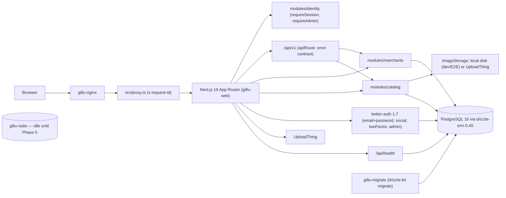

# Gillu — As-Built Architecture

This file describes what is **actually implemented** in the repository.
The approved target architecture lives in
[`diagrams/approved-architecture.txt`](../diagrams/approved-architecture.txt);
decisions in [`diagrams/decisions.md`](../diagrams/decisions.md).

Last verified: 2026-10-28, end of Phase 4, branch `gillu/phase-4`.

## Current state

Phase 1 foundation, Phase 2 merchant authentication, Phase 3 catalog and
Phase 4 customer storefront, plus the Gillu UI on top of the Relivator v1.4.6
template. The `merchants`, `catalog` and `cart` modules exist; orders,
payments and shipping arrive from Phase 5.

| Area | As built |
|---|---|
| Framework | Next.js 16.4, React 19.3, TypeScript 5.9, Tailwind 4, shadcn primitives in `src/ui/primitives` |
| Auth | better-auth 1.7.14: email+password, GitHub/Google social (only when env set), twoFactor, **admin** plugin (`user.role`), `nextCookies()`. Server helpers in `src/lib/auth.ts`; sign-in/sign-up pages show errors instead of redirecting on failure. Production rate limit: sign-in/sign-up 3 per 10 s per client IP. |
| Identity module | `src/modules/identity`: `isAdmin` (domain), `grantAdmin` (application), `requireSession` / `requireAdmin` for pages, `authorizeSession` / `authorizeAdmin` for API routes (public API, server-only). `/admin/*` returns 404 for non-admins. **Rule:** every admin/merchant page and data function calls `requireAdmin()` (or its merchant equivalent) itself — layout guards are UX only, because Next.js still renders the page segment. `requireSession` is `cache()`d per request. First admin via `bun run admin:grant <email>`. |
| Merchants module | `src/modules/merchants/{domain,application,presentation,index.ts}`. **domain**: statuses and transitions, locked fields, slug rules (pure; no IO, env or logger). **application**: `registerMerchant`, `updateMerchantProfile`, `submitMerchant`, review actions (guarded `UPDATE … WHERE status IN`), pickup locations, membership resolution. **presentation**: Zod 4 schemas that normalise Indian phones/PIN codes. **index.ts** (server-only): `authorizeMerchant()` for API routes; `requireMerchant()` / `requireApprovedMerchant()` for pages. The shop always comes from the caller's membership (`MerchantContext`), never from the request. See [merchant-workflow.md](merchant-workflow.md). |
| Cart module | `src/modules/cart/{domain,application,presentation,index.ts}` (ADR-032). **domain**: limits (30 lines, 10 per line) and line status (`unavailable` > `sold_out` > `short` > `price_changed` > `ok`). **application**: `getCart`, `addCartItem`, `updateCartItem`, `removeCartItem`, `mergeGuestCart`; every write locks the cart row. **presentation**: guest cookie (`gillu_cart`, token hashed with SHA-256), request body schemas, `readCartOwner()` |
| Catalog module | `src/modules/catalog/{domain,application,presentation,infrastructure,index.ts}` (ADR-027 to ADR-030). **domain**: money (`parseRupees` → integer paise, `formatPaise`), SKU rules, product status transitions, publish blockers, constants (4 MB / 8 images, low stock ≤ 5). **application**: admin categories; products, variants and stock adjustments (guarded `UPDATE … available + delta >= 0` with a movement row); images; publish/unpublish/archive (guarded transitions, shop re-read, admin hold); admin list/hold/release; `listPurchasableProducts` for Phase 4. **infrastructure**: magic-byte image detection, local disk and UploadThing image storage. **index.ts** (server-only) re-exports. Product, variant and image ids of another shop are 404. See [merchant-workflow.md](merchant-workflow.md#products). |
| Image storage | `ImageStorage` port (`put`, `delete`), chosen by `IMAGE_STORAGE_DRIVER` (ADR-029): `uploadthing` (default; needs `UPLOADTHING_TOKEN`, else uploads answer `503 image_storage_unavailable`) or `local` (files under `IMAGE_STORAGE_LOCAL_DIR`, served by `GET /api/v1/images/<key>` with `nosniff` and a one-year immutable cache; refused in production unless `IMAGE_STORAGE_ALLOW_LOCAL_IN_PRODUCTION=true`). E2E uses `local` in a temp directory. |
| Gillu UI | ADR-026. The source HTML sites are ported as React components with their CSS kept and wrapped in `@scope (.gillu-site)` / `@scope (.gillu-desk)` (`src/css/gillu-{site,desk}.css`); fonts via `next/font/local` (`src/ui/gillu/fonts.ts`). Route groups: `(site)` — the landing page at `/` (`src/ui/gillu/site/*`); `/merchant/*` — the merchant desk shell and pages (`src/ui/gillu/desk/*`: shell, nav, search, heading, panel, badge, modal, empty state, product card and catalog forms); `(starter)` — remaining Relivator pages (`/admin`, `/dashboard`, `/products`, auth) with Tailwind/shadcn. |
| HTTP API | `/api/v1/**` route handlers wrap `apiRoute()` (`src/platform/http.ts`): `{ data }` on success, `{ error: { code, message, details? }, requestId }` on failure, `no-store` always; errors are `AppError` subclasses (`src/platform/errors.ts`). See [api-contracts.md](api-contracts.md). |
| Authorization rule | Every page, route handler and data function authorizes itself (`requireAdmin`, `requireMerchant`, `requireApprovedMerchant`, `authorizeAdmin`, `authorizeMerchant`, `authorizeSession`). Layouts (`/admin`, `/merchant`) are UX only — Next.js renders a page segment without its layout when a client claims the layout is already on screen. E2E sends exactly such a forged RSC request and checks no data leaks. |
| Platform | `src/platform/env.ts` (Zod 4 server env, fails naming variables only), `logger.ts` (pino JSON; `authorization`, `cookie`, `password`, `secret`, `token` redacted at top level and one level down), `request-id.ts`, `health.ts` |
| Request correlation | `src/proxy.ts` sets `x-request-id` on every request/response, reusing a client id only if it matches `^[A-Za-z0-9_-]{8,128}$`; nginx does the same and logs it |
| Database | postgres-js + drizzle-orm 0.45; schema in `src/db/schema/{users,uploads,merchants,catalog}`; **generated migrations** in `drizzle/` (`0000` baseline, `0001` admin columns, `0002` merchants, `0003` catalog, `0004` seeded categories); `runMigrations()` in `src/db/migrate.ts`. See [database-design.md](database-design.md) |
| Uploads | Starter UploadThing routes (`uploads` table, URL + key only) remain for `/dashboard/uploads`; product images use the catalog `ImageStorage` port instead |
| Payments | None. Polar removed (ADR-007); Cashfree arrives in Phase 6 |
| Storefront | `/` is the Gillu landing page: real products once any shop sells, the illustrative previews until then. Shoppers browse `/explore` (search, category, region, made, sort), `/shops/[shop]` (maker story, ADR-034 strip for returning visitors), `/shops/[shop]/[product]` (ADR-033), `/cart`, and `/checkout` (signed-in; Place order waits for Phase 5). The storefront rules live in `catalog/application/storefront.ts`; the public API is `/api/v1/products`, `/api/v1/shops/[shop]` and `/api/v1/cart` |
| Deployment | Compose: postgres, redis, migrate (one-shot), web, nginx (only published port). See [deployment.md](deployment.md) |
| Tests | Vitest unit + Testcontainers integration, Playwright E2E. See [testing.md](testing.md) |

## Reusable pieces for later phases

- shadcn/ui primitives, header/footer, theme components.
- `productOnSale()` and `sellableVariant()` (catalog `storefront.ts`) — the
  purchasable rule: published, not held, approved shop, active category, an
  in-stock active variant. Phase 5 orders should reuse them at checkout.
- `getVariantsForCart()` (catalog) — the cart reads a variant's live price,
  stock and status through it.
- `src/ui/gillu/store/*` — the store UI kit: cards, cart lines, pagination,
  filters and the seen-shops cookie.
- `cart.tsx` / `cart-client.tsx` — starter UI shells (still present; the store
  uses `ui/gillu/store`).
- Notification UI (`notifications/*`) — still backed by a mock file.
- `ImageStorage` port — reusable for shop logos.

## Known gaps / risks carried forward

1. Google OAuth code complete and unit-tested, but not exercised against
   Google (no credentials); E2E uses email/password. `?next=` is carried
   through sign-in/sign-up and accepted only as a same-site path.
2. `/dashboard/*` starter pages (stats, uploads, settings) remain until their
   Gillu equivalents exist.
3. Workers need their own build (ADR-016) and must not import `server-only`.
4. Cashfree/Shiprocket sandbox capabilities unverified until credentials.
5. UploadThing image storage is code complete and covered by unit/integration
   tests of the shared path only; it has not run against UploadThing (no
   token). Compose defaults to `uploadthing`, so product uploads answer 503
   until a token is set.
6. Landing previews are shown only while no shop sells; the festival tabs
   remain illustrative content. Checkout cannot place orders until Phase 5.
