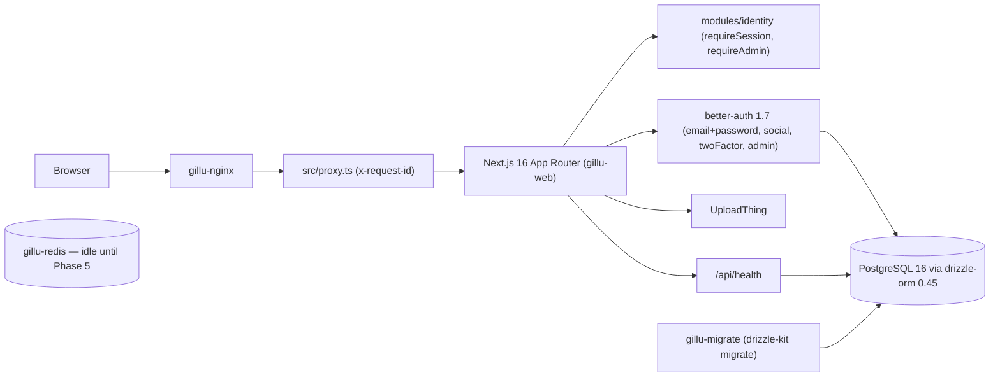

# Gillu — As-Built Architecture

This file describes what is **actually implemented** in the repository.
The approved target architecture lives in
[`diagrams/approved-architecture.txt`](../diagrams/approved-architecture.txt);
decisions in [`diagrams/decisions.md`](../diagrams/decisions.md).

Last verified: 2026-10-27, end of Phase 1, branch `gillu/phase-0-1`.

## Current state

Phase 1 foundation on top of the Relivator v1.4.6 template. No marketplace
modules (merchants, catalog, orders, …) exist yet; they arrive from Phase 2.

| Area | As built |
|---|---|
| Framework | Next.js 16.4, React 19.3, TypeScript 5.9, Tailwind 4, shadcn primitives in `src/ui/primitives` |
| Auth | better-auth 1.7.14: email+password, GitHub/Google social (only when env set), twoFactor, **admin** plugin (`user.role`), `nextCookies()`. Server helpers in `src/lib/auth.ts`; sign-in/sign-up pages show errors instead of redirecting on failure. Production rate limit: sign-in/sign-up 3 per 10 s per client IP. |
| Identity module | `src/modules/identity`: `isAdmin` (domain), `grantAdmin` (application), `requireSession` / `requireAdmin` (public API, server-only). `/admin/*` returns 404 for non-admins. **Rule:** every admin/merchant page and data function calls `requireAdmin()` (or its merchant equivalent) itself — layout guards are UX only, because Next.js still renders the page segment. `requireSession` is `cache()`d per request. First admin via `bun run admin:grant <email>`. |
| Platform | `src/platform/env.ts` (Zod 4 server env, fails naming variables only), `logger.ts` (pino JSON; `authorization`, `cookie`, `password`, `secret`, `token` redacted at top level and one level down), `request-id.ts`, `health.ts` |
| Request correlation | `src/proxy.ts` sets `x-request-id` on every request/response, reusing a client id only if it matches `^[A-Za-z0-9_-]{8,128}$`; nginx does the same and logs it |
| Database | postgres-js + drizzle-orm 0.45; schema in `src/db/schema/{users,uploads}`; **generated migrations** in `drizzle/` (`0000` baseline, `0001` admin columns); `runMigrations()` in `src/db/migrate.ts` |
| Uploads | UploadThing routes; `uploads` table stores URL + key only |
| Payments | None. Polar removed (ADR-007); Cashfree arrives in Phase 6 |
| Storefront | `/`, `/products`, `/products/[id]` still render Relivator **mock data** from `src/app/mocks.ts` — replaced in Phase 4 |
| Deployment | Compose: postgres, redis, migrate (one-shot), web, nginx (only published port). See [deployment.md](deployment.md) |
| Tests | Vitest unit + Testcontainers integration, Playwright E2E. See [testing.md](testing.md) |

## Reusable pieces for later phases

- shadcn/ui primitives, header/footer, theme components.
- `product-card.tsx`, `cart.tsx` / `cart-client.tsx`, `use-cart` — UI shells to
  re-point at real data (Phase 4).
- Notification UI (`notifications/*`) — still backed by a mock file.
- UploadThing route + `uploads` table — basis for product images (ADR-014).

## Known gaps / risks carried forward

1. Google OAuth not exercised (no credentials); E2E uses email/password.
2. `/dashboard/*` starter pages (stats, uploads, settings) remain until their
   Gillu equivalents exist.
3. Workers need their own build (ADR-016) and must not import `server-only`.
4. Cashfree/Shiprocket sandbox capabilities unverified until credentials.
5. Gillu landing-page source not in the repository (Phase 4 dependency).
