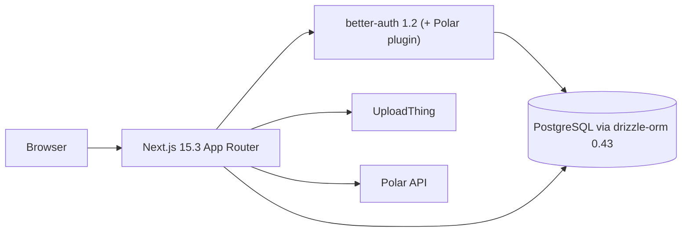

# Gillu — As-Built Architecture

This file describes what is **actually implemented** in the repository.
The approved target architecture lives in
[`diagrams/approved-architecture.txt`](../diagrams/approved-architecture.txt);
decisions in [`diagrams/decisions.md`](../diagrams/decisions.md).

Last verified: 2026-10-27 (Phase 0 audit), branch `gillu/phase-0-1`.

## Current state: Relivator starter

Gillu has not yet diverged from the Relivator v1.4.6 template. Upstream
Relivator HEAD and this repository's base commit are identical.

| Area | As built |
|---|---|
| Framework | Next.js 15.3.2, React 19.1, Tailwind 4.1, shadcn primitives in `src/ui/primitives` |
| Auth | better-auth 1.2.7, Drizzle adapter, email+password, twoFactor, GitHub/Google social (only when env set), Polar plugin. Helpers `getCurrentUser` / `getCurrentUserOrRedirect` in `src/lib/auth.ts`. Auth tables generated into `src/db/schema/users/tables.ts`. |
| Database | postgres-js driver + drizzle-orm 0.43; schema in `src/db/schema/{users,uploads,payments}`; **no migrations** (`drizzle-kit push` only). |
| Uploads | UploadThing routes in `src/app/api/uploadthing/core.ts`; `uploads` table stores URL + key only. |
| Payments | Polar subscriptions: `src/api/payments/service.ts`, `src/app/api/payments/*`, `polar_customer` / `polar_subscription` tables, `/dashboard/billing`. To be removed (ADR-007). |
| Storefront | `/`, `/products`, `/products/[id]` render **mock data** from `src/app/mocks.ts` (USD prices, demo banners). Not real catalog data. |
| Admin | `/admin/summary` lists every user and their uploads; the layout only checks sign-in, **not an admin role** (security gap, fixed in Phase 1 Task 8). |
| Tests | Two `bun:test` files in `.tests/`, both Polar/env oriented. No Vitest, Playwright or Testcontainers. |
| Docker | Multi-stage Dockerfile (bun install → Next standalone → non-root Node runtime); compose with postgres + web only. |

## Reusable pieces

- shadcn/ui primitives (`src/ui/primitives/*`): button, card, dialog, sheet,
  table, data-table, tabs, input, label, badge, skeleton, etc.
- Layout components: `header/`, `footer.tsx`, `theme-provider.tsx`,
  `theme-toggle.tsx`, `page-header.tsx`.
- `product-card.tsx`, `cart.tsx` / `cart-client.tsx`, `use-cart` hook — UI shells
  to be re-pointed at real data (Phase 4).
- Notification UI (`notifications/*`) — currently backed by a mock file.
- Auth pages under `src/app/auth/*` (sign-in, sign-up, sign-out, MFA).
- UploadThing route + `uploads` table — basis for product images (ADR-014).

## Technical risks

1. Next 15→16 and better-auth 1.2→1.7 upgrades combined with Polar removal can
   break auth; mitigated by an auth E2E test written before the change.
2. better-auth 1.7 requires drizzle-orm ≥ 0.45.2.
3. Workers cannot run from Next's standalone bundle; they need their own build
   and must not import `server-only` code.
4. Google OAuth cannot be automated in Playwright; E2E uses email/password.
5. Cashfree/Shiprocket sandbox capabilities are unverified until credentials
   are supplied.
6. Gillu landing-page source is not in the repository (Phase 4 dependency).
