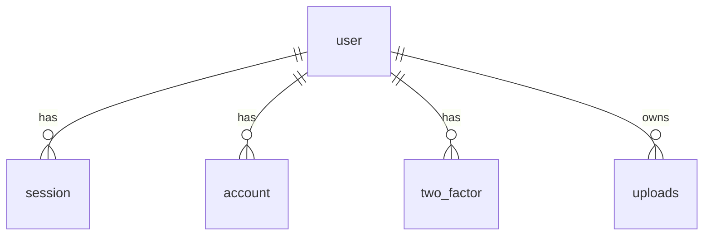

# Database Design

Status: Phase 1 — auth and uploads tables only. Marketplace tables are added
from Phase 2 (plan in [design](superpowers/specs/2026-10-27-gillu-marketplace-design.md) §6).

## Workflow

- Schema source: `src/db/schema/<module>/` (exported from `src/db/schema/index.ts`).
- Auth tables are generated by `bun run db:auth` (better-auth CLI pinned to
  the installed better-auth version) into `src/db/schema/users/tables.ts`;
  generated relations are stripped and the script fails if a table would be lost; relations are hand-maintained in
  `src/db/schema/users/relations.ts`.
- `bun run db:generate` writes SQL to `drizzle/`; review and commit it.
- `bun run db:migrate` (and the Compose `migrate` service) applies it.
  `drizzle-kit push` is for throwaway local databases only.

## Migrations

| Migration | Contents |
|---|---|
| `0000_tidy_trish_tilby` | `user`, `session`, `account`, `verification`, `two_factor`, `uploads`, enum `type` (image/video); indexes on session/account `user_id`, two_factor `secret`/`user_id`, verification `identifier` |
| `0001_tough_malcolm_colcord` | admin plugin: `user.role`, `user.banned` (default false), `user.ban_reason`, `user.ban_expires`, `session.impersonated_by` — additive only |

## Current tables

| Table | Notes |
|---|---|
| `user` | better-auth user + `age`, `first_name`, `last_name`, admin `role` (comma-separated list; `admin` grants admin) |
| `session` | cascade-deleted with user; `impersonated_by` unused |
| `account` | credential/social accounts; cascade with user |
| `verification` | email/OTP verification values |
| `two_factor` | TOTP secret, backup codes, `verified`, `failed_verification_count`, `locked_until` |
| `uploads` | UploadThing `key` + `url` per user; no binaries in Postgres |

Polar tables (`polar_customer`, `polar_subscription`) were never migrated and
no longer exist in the schema.
