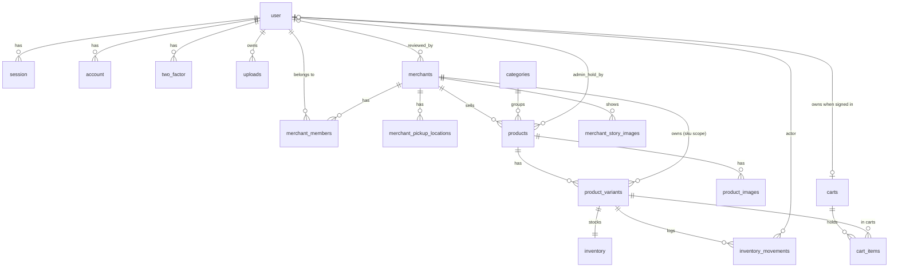

# Database Design

Status: Phase 4 — auth, uploads, merchant, catalog, shop story and cart tables. Further marketplace
tables follow the plan in [design](superpowers/specs/2026-10-27-gillu-marketplace-design.md) §6.

## Workflow

- Schema source: `src/db/schema/<module>/` (exported from `src/db/schema/index.ts`).
- Auth tables are generated by `bun run db:auth` (better-auth CLI pinned to
  the installed better-auth version) into `src/db/schema/users/tables.ts`;
  generated relations are stripped and the script fails if a table would be lost; relations are hand-maintained in
  `src/db/schema/users/relations.ts`.
- `bun run db:generate` writes SQL to `drizzle/`; review and commit it.
- `bun run db:migrate` (and the Compose `migrate` service) applies it.
  `drizzle-kit push` is for throwaway local databases only.

## Migrations

| Migration | Contents |
|---|---|
| `0000_tidy_trish_tilby` | `user`, `session`, `account`, `verification`, `two_factor`, `uploads`, enum `type` (image/video); indexes on session/account `user_id`, two_factor `secret`/`user_id`, verification `identifier` |
| `0001_tough_malcolm_colcord` | admin plugin: `user.role`, `user.banned` (default false), `user.ban_reason`, `user.ban_expires`, `session.impersonated_by` — additive only |
| `0002_military_paibok` | Phase 2: enums `merchant_status`, `merchant_member_role`; tables `merchants`, `merchant_members`, `merchant_pickup_locations` with their foreign keys, indexes and CHECK — additive only (no DROP/ALTER of existing tables) |
| `0003_cultured_wendell_vaughn` | Phase 3: enums `product_status`, `inventory_movement_reason`; tables `categories`, `products`, `product_variants`, `product_images`, `inventory`, `inventory_movements` with foreign keys, unique constraints, CHECKs and indexes — additive only |
| `0004_seed_categories` | Custom migration: the seven launch categories (ids `cat_<slug>`), `ON CONFLICT DO NOTHING` so a re-run or an admin-created duplicate never fails |
| `0005_bent_gamma_corps` | Phase 4: enums `composition_label` (INGREDIENTS, MATERIALS) and `made_how` (HANDMADE, HOMEMADE); tables `carts`, `cart_items`, `merchant_story_images` with foreign keys, unique constraints, CHECKs and indexes; new columns `categories.composition_label`, `products.composition`, `made_by`, `made_how`, `origin_place`, `origin_state`, `merchants.home_place`, `home_state`, `story`; indexes on product origin, made_how and `(status, published_at)`; a data update sets the craft categories to MATERIALS — additive only (no DROP, the data update touches only category labels) |

## Current tables

| Table | Notes |
|---|---|
| `user` | better-auth user + `age`, `first_name`, `last_name`, admin `role` (comma-separated list; `admin` grants admin) |
| `session` | cascade-deleted with user; `impersonated_by` unused |
| `account` | credential/social accounts; cascade with user |
| `verification` | email/OTP verification values |
| `two_factor` | TOTP secret, backup codes, `verified`, `failed_verification_count`, `locked_until` |
| `uploads` | UploadThing `key` + `url` per user; no binaries in Postgres |
| `merchants` | One shop. `slug` unique (`merchants_slug_unique`); `status` enum `merchant_status` (DRAFT, SUBMITTED, APPROVED, REJECTED, SUSPENDED; default DRAFT, indexed); contact name/email/phone (`+91…`); `business_address` and `return_address` jsonb (`line1`, `line2?`, `city`, `state`, `postalCode`); optional `description`, `logo_url`, `gstin`, `pan`, `fssai_license`, `compliance_notes`; `compliance_verified_at` (null = unverified, ADR-025); `submitted_at`, `reviewed_at`, `reviewed_by` → `user` (set null), `rejection_reason` |
| `merchant_members` | `merchant_id` → `merchants` and `user_id` → `user` (both cascade); `role` enum owner/staff; unique (`merchant_id`, `user_id`); partial unique index `merchant_members_one_owned_per_user` on `user_id` WHERE `role = 'owner'` (one owned shop per user, ADR-023) |
| `merchant_pickup_locations` | `merchant_id` → `merchants` (cascade); `label`, `contact_name`, `phone`, `line1`, `line2?`, `city`, `state`, `postal_code` (CHECK `^[1-9][0-9]{5}$`), `is_primary`; partial unique index `merchant_pickup_locations_one_primary` on `merchant_id` WHERE `is_primary`; `provider_location_name` reserved for Shiprocket (Phase 7) |

| `categories` | Admin-managed list. `name` and `slug` unique (`categories_name_unique`, `categories_slug_unique`); `is_active` (hidden categories cannot be chosen and their products are not purchasable); `sort_order`. Slug stays fixed on rename |
| `products` | `merchant_id` → `merchants` and `category_id` → `categories` (both restrict); `name`, `slug` (unique per shop, `products_merchant_slug_unique`), `description`; `status` enum `product_status` (DRAFT, PENDING_APPROVAL — reserved, PUBLISHED, UNPUBLISHED, ARCHIVED); `currency` CHECK `= 'INR'`; `published_at` (first publish); admin hold `admin_hold_reason`, `admin_hold_by` → `user` (set null), `admin_hold_at`; index (`merchant_id`, `status`) |
| `product_variants` | `product_id` → `products` (cascade), `merchant_id` → `merchants` (restrict; denormalised for SKU scope); `label` (null only for a single default variant), `sku` unique per shop (`product_variants_merchant_sku_unique`); `price_paise` (bigint, CHECK > 0), `declared_mrp_paise` (CHECK ≥ price when set); `weight_grams`, `length_mm`, `width_mm`, `height_mm` (CHECK > 0); `is_active`; `sort_order` |
| `product_images` | `product_id` → `products` (cascade); `storage_key`, `url`, `alt`, `width`, `height`, `bytes`, `content_type`, `sort_order`. Bytes live in image storage, never in Postgres |
| `inventory` | One row per variant (`variant_id` PK → `product_variants`, cascade); `available`, `reserved` (both CHECK ≥ 0; `reserved` used from Phase 5) |
| `carts` | One cart per signed-in user (`user_id` unique, cascade with user) or per guest (`guest_token_hash` unique: SHA-256 of the random cookie value, never the token itself). CHECK: exactly one owner. Created on the first write; read requests never create one |
| `cart_items` | `cart_id` → `carts` and `variant_id` → `product_variants` (both cascade); `quantity` CHECK 1–10; `unit_price_paise_seen` (bigint) — the price the shopper last saw, compared with the live price to show a price change; unique (`cart_id`, `variant_id`); index on `variant_id` |
| `merchant_story_images` | Shop photos: `merchant_id` → `merchants` (cascade); `storage_key`, `url`, `alt`, `width`, `height`, `bytes`, `content_type`, `sort_order`. Same byte rules and storage port as product images; index on `merchant_id` |
| `inventory_movements` | Append-only log: `variant_id` → `product_variants` (cascade), `delta` (CHECK ≠ 0), `available_after`, `reason` enum (INITIAL, RESTOCK, DAMAGED, CORRECTION, OTHER), `note`, `actor_user_id` → `user` (set null); index on `variant_id` |

Money is integer paise everywhere (ADR-027); no floating point. Stock only
changes through a guarded `UPDATE inventory SET available = available + $d
WHERE variant_id = $v AND available + $d >= 0` in the same transaction as
its movement row (ADR-030).

All Phase 2 to 4 timestamps are `timestamptz`. Ids are text cuid2 values generated in the
application (`createId()`). The merchant and catalog schema files use relative imports because
drizzle-kit does not resolve the `~` alias.

Polar tables (`polar_customer`, `polar_subscription`) were never migrated and
no longer exist in the schema.
