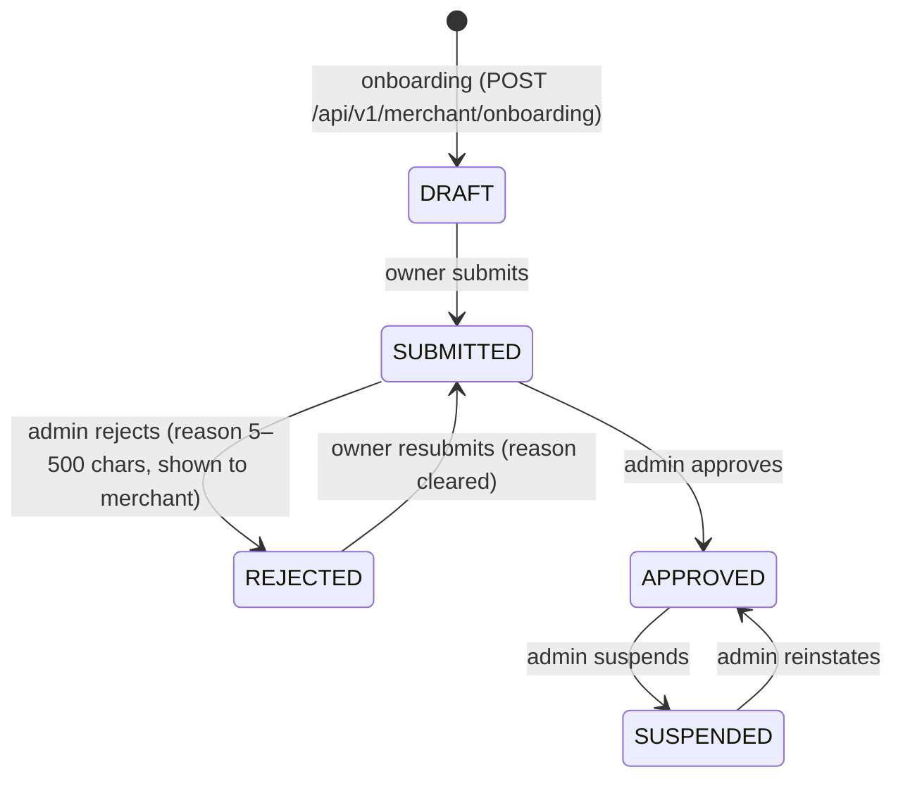

# Merchant Workflow

Status: Phase 2 — onboarding, review, profile and pickup locations are
implemented and verified (2026-10-27, branch `gillu/phase-2`).

Governed by: [design](superpowers/specs/2026-10-27-gillu-marketplace-design.md), requirements §8, §14, §19.
Decisions: ADR-022 to ADR-025 in [`diagrams/decisions.md`](../diagrams/decisions.md).

## Statuses

- Transitions live in `src/modules/merchants/domain/status.ts`. Any other
  transition is `409 invalid_transition`.
- Each transition is one guarded `UPDATE … WHERE status IN (<allowed from>)`.
  Two admins acting on the same submission at once: exactly one wins, the
  other gets `409 invalid_transition` (integration test).
- Approve works only from SUBMITTED and reinstate only from SUSPENDED, so a
  stale "Approve" click cannot lift a suspension.
- Only APPROVED merchants can sell (`canSell`). Suspension applies on the
  merchant's next request: every merchant page and API call re-reads the
  status from the database.

## Who can do what

| Actor | Can |
|---|---|
| Signed-in user without a shop | Onboard once (creates DRAFT shop, owner membership, primary pickup location in one transaction) |
| Owner | Edit profile (subject to locks), submit / resubmit, manage pickup locations, see dashboard once APPROVED |
| Staff member | Read the profile and pickup locations, manage pickup locations; cannot edit the profile or submit. (Staff invitations arrive later; memberships can exist today only through the database.) |
| Admin (`user.role` contains `admin`) | List and read every shop, approve, reject, suspend, reinstate |

- A user owns at most one shop (ADR-023). A second onboarding attempt is
  `409 already_merchant_owner`, even when two requests race.
- The current shop comes from the user's membership, never from the request
  (owner membership first, then the oldest membership).
- Pickup location ids belonging to another shop are `404` — never `403` —
  so ids cannot be probed.

## Pages

| Path | Guard (in the page itself) | Shows |
|---|---|---|
| `/merchant/onboarding` | `requireSession` | No shop: the onboarding form ("Create shop"). DRAFT: "Your shop is a draft" + "Submit for review". SUBMITTED: "Your shop is under review". REJECTED: "Your shop needs changes" + the admin's reason. SUSPENDED: "Your shop is suspended". APPROVED: redirect to the dashboard |
| `/merchant/profile` | `requireMerchant` | Profile form; locked fields disabled with "Locked after approval — contact Gillu to change"; "Unverified" badge until compliance is confirmed |
| `/merchant/settings/shipping` | `requireMerchant` | Pickup locations, "Make primary", add a location |
| `/merchant/dashboard` | `requireApprovedMerchant` | Store name, "Approved", shop URL `/shops/<slug>`, primary pickup location. No sales or product numbers yet (no mock data) |
| `/admin/merchants` | `requireAdmin` | Review queue with status tabs |
| `/admin/merchants/[id]` | `requireAdmin` | Full onboarding details, registrations ("Unverified"), pickup locations, actions allowed for the current status only |

Signed-out visitors are sent to `/auth/sign-in?next=<path>`; `next` is
accepted only when it is a same-site path (`src/lib/safe-next-path.ts`).
The header links "Sell on Gillu" to `/merchant/onboarding`.

## Locked fields (ADR-024)

| Status | Locked |
|---|---|
| DRAFT, REJECTED | nothing |
| SUBMITTED | everything (`409 under_review`) |
| APPROVED, SUSPENDED | `storeName`, `slug`, `gstin`, `pan`, `fssaiLicense` (`409 field_locked` with `details.fields`) |

Unchanged locked values may be sent back (forms post every field); only a
change is refused.

## Input rules (Indian addresses and phones)

- Mobile numbers accept `+91`, `91`, `0` prefixes, spaces, dashes and
  brackets; stored as `+91XXXXXXXXXX`. Must start 6–9.
- PIN codes accept spaces (`560 001`); stored as six digits, no leading 0.
  The database also enforces this on pickup locations (CHECK constraint).
- Shop URL (slug): lowercase letters, digits and single hyphens; reserved
  words (`admin`, `api`, `auth`, `gillu`, `merchant(s)`, `new`, `settings`,
  `shop(s)`) refused. The form suggests one from the store name.
- Logo: an `https://` URL only (uploads arrive with the catalog).

## Compliance (ADR-025)

GSTIN, PAN, FSSAI licence and notes are optional and uppercased. They are
stored as the merchant declared them and shown as "Unverified" until
`compliance_verified_at` is set. Nothing sets it yet: Gillu has not
confirmed which registrations each merchant type needs.

## Google sign-in

Google (and GitHub) buttons appear only when both the client id and secret
are configured. Google asks the user to pick an account
(`prompt: select_account`). Code complete and unit-tested; **manual
verification needs real Google OAuth credentials (NEEDS_INPUT).**
