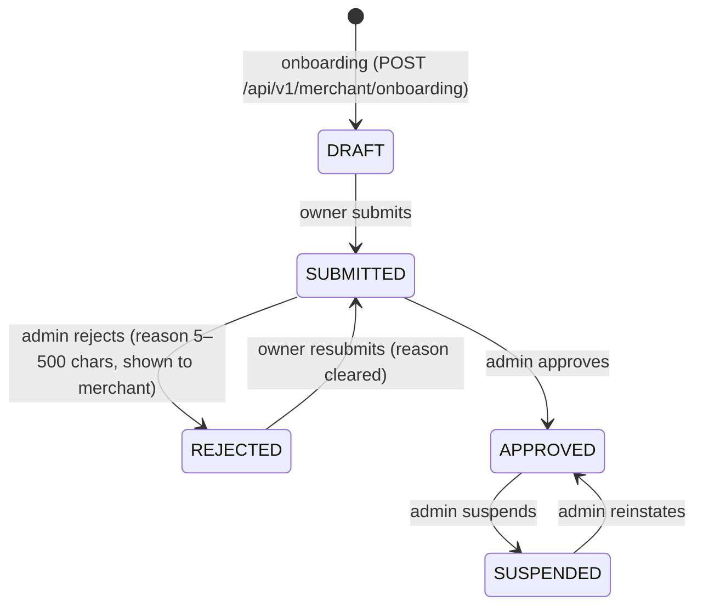
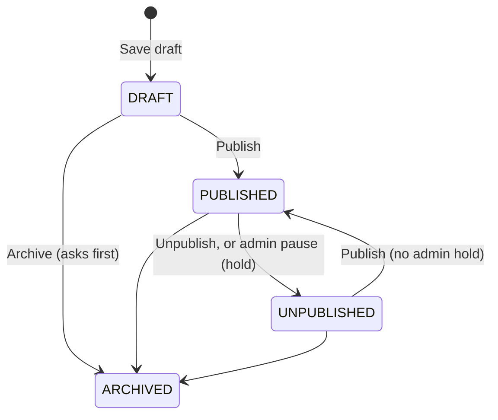

# Merchant Workflow

Status: Phase 4 — onboarding, review, profile, pickup locations, the product
catalog and the shop story are implemented and verified (2026-10-28, branch
`gillu/phase-4`; catalog verified 2026-10-27 on `gillu/phase-3`).

Governed by: [design](superpowers/specs/2026-10-27-gillu-marketplace-design.md), requirements §8, §14, §19.
Decisions: ADR-022 to ADR-025 in [`diagrams/decisions.md`](../diagrams/decisions.md).

## Statuses

- Transitions live in `src/modules/merchants/domain/status.ts`. Any other
  transition is `409 invalid_transition`.
- Each transition is one guarded `UPDATE … WHERE status IN (<allowed from>)`.
  Two admins acting on the same submission at once: exactly one wins, the
  other gets `409 invalid_transition` (integration test).
- Approve works only from SUBMITTED and reinstate only from SUSPENDED, so a
  stale "Approve" click cannot lift a suspension.
- Only APPROVED merchants can sell (`canSell`). Suspension applies on the
  merchant's next request: every merchant page and API call re-reads the
  status from the database.

## Who can do what

| Actor | Can |
|---|---|
| Signed-in user without a shop | Onboard once (creates DRAFT shop, owner membership, primary pickup location in one transaction) |
| Owner | Edit profile (subject to locks), submit / resubmit, manage pickup locations, see dashboard once APPROVED |
| Staff member | Read the profile and pickup locations, manage pickup locations; cannot edit the profile or submit. (Staff invitations arrive later; memberships can exist today only through the database.) |
| Admin (`user.role` contains `admin`) | List and read every shop, approve, reject, suspend, reinstate; manage categories; pause (hold) and release products |

- A user owns at most one shop (ADR-023). A second onboarding attempt is
  `409 already_merchant_owner`, even when two requests race.
- The current shop comes from the user's membership, never from the request
  (owner membership first, then the oldest membership).
- Pickup location ids belonging to another shop are `404` — never `403` —
  so ids cannot be probed.

## Pages

| Path | Guard (in the page itself) | Shows |
|---|---|---|
| `/merchant/onboarding` | `requireSession` | No shop: the onboarding form ("Create shop"). DRAFT: "Your shop is a draft" + "Submit for review". SUBMITTED: "Your shop is under review". REJECTED: "Your shop needs changes" + the admin's reason. SUSPENDED: "Your shop is suspended". APPROVED: redirect to the dashboard |
| `/merchant/profile` | `requireMerchant` | Profile form; locked fields disabled with "Locked after approval — contact Gillu to change"; "Unverified" badge until compliance is confirmed |
| `/merchant/settings/shipping` | `requireMerchant` | Pickup locations, "Make primary", add a location |
| `/merchant/dashboard` | `requireApprovedMerchant` | Store name, "Approved", shop URL `/shops/<slug>`, live product count, catalog metrics (published, drafts, out of stock, low stock), primary pickup location. No sales numbers yet (no mock data) |
| `/merchant/products` | `requireApprovedMerchant` | Product cards with search (`?q`) and status filter (`?status`) |
| `/merchant/products/new` | `requireApprovedMerchant` | New product form ("Save draft") |
| `/merchant/products/[id]` | `requireApprovedMerchant` | Details, photos (upload, describe, reorder, remove), variants (add, edit, switch off/on) and stock (adjust, recent changes), publish blockers, admin hold notice, Publish / Unpublish / Archive |
| `/admin/categories` | `requireAdmin` | Add, rename, hide/show and order categories |
| `/admin/products` | `requireAdmin` | Every shop's products with status tabs; pause with a reason, release |
| `/admin/merchants` | `requireAdmin` | Review queue with status tabs |
| `/admin/merchants/[id]` | `requireAdmin` | Full onboarding details, registrations ("Unverified"), pickup locations, actions allowed for the current status only |

Signed-out visitors are sent to `/auth/sign-in?next=<path>`; `next` is
accepted only when it is a same-site path (`src/lib/safe-next-path.ts`).
The header links "Sell on Gillu" to `/merchant/onboarding`.

## Products

Owners and staff of an **APPROVED** shop manage products (pages redirect
others to onboarding; the API answers 403). Suspension applies on the next
request. Decisions: ADR-027 to ADR-030.

- **Publishing** is direct for approved shops (ADR-028). It re-reads the
  shop's status and needs an active category, an active variant with a
  price and at least one image; otherwise `409 not_publishable` with
  `details.missing` (`category`, `variant`, `image`) and the page lists
  "Before you can publish:".
- **Admin hold:** an admin pauses a published product with a reason (5–500
  characters). It becomes UNPUBLISHED, the merchant sees "Gillu has paused
  this product: <reason>" and cannot publish (`409 admin_hold`) until an
  admin releases it; release leaves it UNPUBLISHED. A held product can
  still be edited or archived.
- **Archived** is final: read-only, no restore.
- **Variants** carry price, declared MRP, SKU, packed weight and dimensions,
  and stock (ADR-027). A new product has one unlabelled variant; adding a
  second requires labels on all (the desk asks for the first one's name).
  Variants are switched off, never deleted; a published product keeps at
  least one active variant (`409 last_variant`).
- **Money:** merchants type rupees ("₹1,299.50", "1,00,000"); stored as
  integer paise. "Price customers pay (including delivery)" must not exceed
  "Declared MRP (as printed on the pack, if any)" (Legal Metrology).
- **SKU:** trimmed, uppercased, letters/digits/`-`/`_`, up to 40, unique per
  shop (`409 sku_taken`). **Slug:** from the name, unique per shop (a
  suffix is added), editable while DRAFT only.
- **Stock** is set when a variant is created (movement INITIAL) and then
  changes only through adjustments with a reason (RESTOCK, DAMAGED,
  CORRECTION, OTHER); never below zero (`409 insufficient_stock`), also
  under concurrent adjustments (ADR-030). Low stock: an active variant with
  5 or fewer.
- **Images:** JPEG, PNG or WebP detected from the bytes, up to 4 MB, 8 per
  product (ADR-029). Alt text defaults to the product name and can be
  edited; photos can be reordered (the first is the cover). A published
  product keeps at least one photo (`409 last_image`).
- **Desk edit page:** edit a variant's price, MRP, SKU, name and pack size;
  adjust stock with the last 20 changes listed in the dialog.
- **Purchasable** (the storefront rule): PUBLISHED, no hold, shop APPROVED,
  category active, an active variant with stock (`productOnSale` and
  `sellableVariant` in `catalog/application/storefront.ts`). Products
  disappear from the storefront as soon as one of these stops holding.
- **Publish checklist** (`publishBlockers`): category, variant, image,
  origin, made by, made how, composition, and `shop_story`. A product that is
  already PUBLISHED cannot clear its made-by, made-how, origin or composition
  (`409 story_required`); unpublish it first.

## Shop story (ADR-031)

The shop's story is the page shoppers read about the maker. It is complete
when it has all four of these:

- the story text, at least 150 characters (up to 3000);
- a village or town (`homePlace`, up to 60 characters);
- a state from the list (`homeState`);
- at least one photo (up to 6, JPEG, PNG or WebP, 4 MB each).

While the shop has a product on sale, it stays complete: clearing the text or
place, or deleting its last photo, is refused (`409 story_required`,
`409 last_story_image`). Before any product can publish the shop's story must
be complete. Staff can see and edit the story; only the owner changes the
shop's details. The desk's **Your story** panel on `/merchant/profile` holds
the text, place, state and photos. Photos can be reordered; the first one is
the cover on the shop page.

## Locked fields (ADR-024)

| Status | Locked |
|---|---|
| DRAFT, REJECTED | nothing |
| SUBMITTED | everything (`409 under_review`) |
| APPROVED, SUSPENDED | `storeName`, `slug`, `gstin`, `pan`, `fssaiLicense` (`409 field_locked` with `details.fields`) |

Unchanged locked values may be sent back (forms post every field); only a
change is refused.

## Input rules (Indian addresses and phones)

- Mobile numbers accept `+91`, `91`, `0` prefixes, spaces, dashes and
  brackets; stored as `+91XXXXXXXXXX`. Must start 6–9.
- PIN codes accept spaces (`560 001`); stored as six digits, no leading 0.
  The database also enforces this on pickup locations (CHECK constraint).
- Shop URL (slug): lowercase letters, digits and single hyphens; reserved
  words (`admin`, `api`, `auth`, `gillu`, `merchant(s)`, `new`, `settings`,
  `shop(s)`) refused. The form suggests one from the store name.
- Logo: an `https://` URL only (uploads arrive with the catalog).

## Compliance (ADR-025)

GSTIN, PAN, FSSAI licence and notes are optional and uppercased. They are
stored as the merchant declared them and shown as "Unverified" until
`compliance_verified_at` is set. Nothing sets it yet: Gillu has not
confirmed which registrations each merchant type needs.

## Google sign-in

Google (and GitHub) buttons appear only when both the client id and secret
are configured. Google asks the user to pick an account
(`prompt: select_account`). Code complete and unit-tested; **manual
verification needs real Google OAuth credentials (NEEDS_INPUT).**
