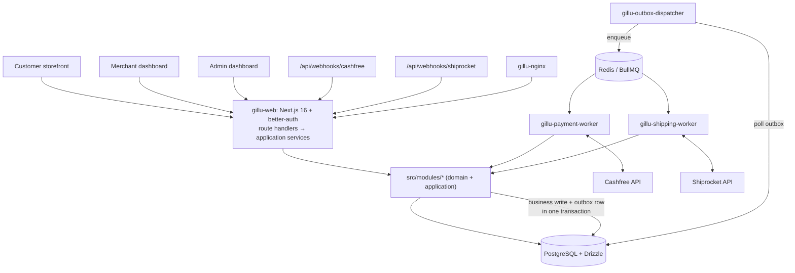

# Gillu Marketplace — Design

Date: 2026-10-27
Status: APPROVED by user 2026-10-27
Requirements source (authoritative, verbatim): `diagrams/implementation-prompt.txt`
This document records *how* those requirements will be met in this repository,
what was decided, and what the audit found. It does not restate every
requirement; where the two disagree, the requirements file wins unless this
document records an explicit decision.

---

## 1. Intent

Turn the Relivator starter (Next.js e-commerce template) into **Gillu**, a
multi-vendor marketplace for Indian traditional, regional and festive goods.
Many independent merchants sell through one storefront; one customer cart can
hold products from several merchants; each merchant fulfils its own parcel
through Shiprocket; prepaid payments go through Cashfree, COD is supported.
Gillu's PostgreSQL database is the authoritative record of every order.

Success = the 22 acceptance criteria in requirements §31, each verified by a
real test or, for external providers, by documented sandbox verification.

## 2. Goals, non-goals, anti-goals

**Goals**
- Incremental delivery in the 10 phases of requirements §26; every phase ends
  with green typecheck, lint, unit, integration, relevant E2E and production
  build.
- Modular monolith with explicit module boundaries; two worker processes and an
  outbox dispatcher as separate deployables sharing the same codebase and DB.
- Correctness under concurrency and retries: no negative stock, no duplicate
  orders/payments/shipments, no double charging.

**Non-goals** — everything in requirements §27 (Polar, Stripe, Razorpay,
payouts, commissions, coupons, wallet, multi-currency, Kubernetes, separate
microservice databases, etc.).

**Anti-goals** (failure even if it "works")
- A provider integration reported as working when only a mock passed.
- UI pages backed by hardcoded/mock data presented as real.
- Business rules inside React components or route handlers.
- Progress docs that claim completion the code and tests don't prove.
- Finance arithmetic in floating point.

## 3. Audit findings (Phase 0 input)

Verified against the working tree on 2026-10-27, branch `main`, HEAD `a1871b0`.

| Area | Finding |
|---|---|
| Upstream | Local checkout == upstream Relivator HEAD (v1.4.6). Nothing newer to pull. |
| Progress claims | `diagrams/implementation-progress.md` claimed Phases 0–1 done and merchant schema built. **False**: Polar is fully wired, no merchant tables, no `docs/`, no installed deps, no Vitest/Playwright. File will be reset. |
| Toolchain on host | Node 26.7, npm, pnpm, Docker present. **bun not installed**, `node_modules` absent. |
| Framework | Next 15.3.2, React 19.1, Tailwind 4.1, shadcn primitives in `src/ui/primitives`. |
| Auth | better-auth 1.2.7, Drizzle adapter, email+password, twoFactor plugin, GitHub + Google social (only when env set), **Polar plugin**. `getCurrentUser`/`getCurrentUserOrRedirect` helpers in `src/lib/auth.ts`. Auth schema generated into `src/db/schema/users/tables.ts` by `bun db:auth`. |
| DB | `postgres` (postgres-js) driver + drizzle-orm 0.43. Schema in `src/db/schema/{users,uploads,payments}`. **No migrations** — only `drizzle-kit push`. No `DATABASE_URL` in `.env` → no existing database data to preserve. |
| Polar footprint | `src/lib/auth.ts` (plugin + client), `src/api/payments/service.ts`, `src/app/api/payments/{customer-state,subscriptions}/route.ts`, `src/db/schema/payments/*` (polar_customer, polar_subscription), `src/app/dashboard/billing/*`, `src/ui/components/payments/PaymentForm.tsx`, `.tests/payments.test.ts`, `.tests/env.test.ts`, `.env.example`, `.env.docker.example`, README, deps `@polar-sh/better-auth`, `@polar-sh/sdk`. |
| Uploads | UploadThing (`src/app/api/uploadthing/core.ts`), `uploads` table stores URL + key only (no binaries). Reusable for product images. |
| Tests | Only `bun:test` files in `.tests/`, both Polar-oriented mocks. No Vitest, Playwright, Testcontainers. |
| Storefront | `src/app/page.tsx`, `products/*` render **mock data** from `src/app/mocks.ts` (USD prices, Ukraine banner). Must be replaced by DB-backed Gillu pages in Phase 4. |
| Docker (uncommitted) | Multi-stage Dockerfile (bun install → Next standalone → node runtime, non-root). `docker-compose.yml` has postgres + web only; README diff describes a `db-setup` service that compose lacks (drift). `.env.docker.example` still lists Polar vars. |
| Other uncommitted | `next.config.ts` adds `output: "standalone"`; `src/lib/queries/uploads.ts` rewritten from relational query to join (keep). |
| Zod | Dependency present but **unused** in `src/`. |

**Technical risks**
1. Next 15→16 and better-auth 1.2→1.7 upgrades together with Polar removal —
   auth regression risk. Mitigated by an E2E auth smoke test written *before*
   the upgrade and re-run after.
2. better-auth 1.7 requires drizzle-orm ≥ 0.45.2 → forced Drizzle minor bump.
3. Worker processes can't run from Next's standalone bundle; they need their
   own build (see §7). `server-only` imports throw outside React Server
   conditions — domain/application code shared with workers must not import it.
4. Google OAuth cannot be automated in Playwright; E2E uses email/password test
   users. Google sign-in is verified manually once credentials exist.
5. Cashfree/Shiprocket sandbox behaviour (webhook signing, which Shiprocket
   endpoints work in sandbox, multi-pickup-location on a platform account) is
   unverified until credentials are supplied — will be marked BLOCKED, never
   faked.
6. Landing-page source (`gillu-festive-haat…chatgpt.site`) is not in the repo.
   Phase 4 depends on obtaining it or rebuilding from the hosted page.

## 4. Decisions

Decided by the user (2026-10-27):
- **D1** Upgrade to latest **Next.js 16**, latest **better-auth (1.7.x)**,
  **Zod 4**. Everything else stays on its current major, moved to latest
  minor/patch where needed for compatibility (drizzle-orm 0.45, React 19.x).
- **D2** Progress file is reset; nothing counts as done until verified.
- Plus every decision fixed in the requirements (§3 there): Drizzle, Postgres,
  modular monolith, BullMQ workers, Cashfree, Shiprocket, better-auth + Google,
  remove Polar.

My calls (builder defaults — the user may override any of these):
- **C1 Package manager: keep bun** (repo has `bun.lock`, scripts, Dockerfile use
  bun). Install bun on the host user-locally. Node remains the runtime for
  Next and workers.
- **C2 Tracking files:** `diagrams/approved-architecture.txt`,
  `diagrams/implementation-progress.md`, `diagrams/decisions.md` are canonical
  (user instruction). `docs/implementation-progress.md` and `docs/decisions.md`
  (required by spec §28) are short pointers to them, to avoid two drifting
  copies. All other `docs/*` files are canonical in `docs/`.
- **C3 Roles:** better-auth **admin plugin** supplies `user.role`
  (`user` | `admin`) → ADMIN. CUSTOMER = any authenticated user. MERCHANT =
  membership row in `merchant_members` (role `owner` | `staff`) on a merchant;
  merchant capabilities additionally require merchant status `APPROVED`.
  A user can be customer + merchant member of several merchants.
- **C3a Admin bootstrap:** no self-service admin. A CLI script
  (`bun run admin:grant <email>`) sets `role = admin` for an existing user;
  documented in `docs/deployment.md`. E2E seeds its admin the same way.
- **C4 IDs:** text primary keys generated with cuid2 (matches existing tables).
  Human-facing order numbers from a Postgres sequence: `GIL-<n>` for parent
  orders, `GIL-<n>-<A|B|…>` for merchant suborders.
- **C5 Money:** integer paise in `bigint` columns (`mode: "number"`, values
  checked ≤ `Number.MAX_SAFE_INTEGER` at the boundary); a `Money` value object
  for arithmetic; API returns integer paise. Conversion to rupees only at
  provider adapters and display formatting.
- **C6 Migrations:** switch from `drizzle-kit push` to `drizzle-kit generate` +
  `drizzle-kit migrate`, committed under `drizzle/`. First migration is the
  baseline (auth + uploads tables, without Polar tables). `db:push` removed from
  docs; kept only as a local throwaway convenience, never in Docker.
- **C7 Image storage:** reuse UploadThing for MVP behind a small
  `ImageStorage` port in catalog; S3-compatible adapter deferred (ADR).
- **C8 Logging:** `pino` JSON logger + request/correlation id set in
  `proxy.ts` (Next 16 name for middleware) and propagated to outbox events and
  jobs. Sentry wired only when `SENTRY_DSN` is set (Phase 9).
- **C9 Worker build:** `bun build --target=node` bundles each worker entry
  (`src/workers/*.ts`) to `dist/workers/*.js`; worker images run them with
  `node`. Same image as web, different command — one image build per release.
- **C10 Phase 1 Docker scope:** postgres, redis, one-shot `migrate`, web, nginx.
  Outbox dispatcher, payment worker, shipping worker join compose in the phase
  that gives them real work (5, 6, 7), so no service runs as an empty shell.
- **C11 Starter pages:** Relivator demo pages (`/dashboard/*` billing, stats,
  uploads; mock storefront) are removed or replaced in the phase that supplies
  the real equivalent; billing is removed in Phase 1 with Polar.
- **C12 Existing `bun:test` suite** is replaced by Vitest; the Polar tests are
  deleted, the env test is ported.

Deferred (recorded as ADRs, not built):
- Settlement / payout rules (requirements §16, settlement diagram).
- Final pricing formula and commission percentages (requirements §13).
- Merchant penalty policy (requirements §14).
- S3-compatible storage adapter (C7).
- Per-merchant Shiprocket accounts (requirements §17).

## 5. Architecture



Workers call the same application services as the web app (imported code, same
DB); they never write other modules' tables directly.

### 5.1 Source layout

```
src/
  app/                      Next routes (pages + /api/v1 handlers) — thin
  modules/
    <module>/
      domain/               entities, value objects, state machines (pure TS, no IO)
      application/          use cases; take a db/tx + ports as arguments
      infrastructure/       Drizzle queries, provider adapters, job processors
      presentation/         Zod DTOs, mappers to API responses
      index.ts              the module's public interface — other modules import only this
  db/schema/<module>/       Drizzle tables per module (spec §21)
  platform/                 cross-cutting: logger, errors, http helpers, outbox, idempotency, queue
  workers/                  process entrypoints: payment.ts, shipping.ts, outbox-dispatcher.ts
  lib/auth.ts               better-auth instance (identity module wraps it)
tests/
  unit/                     Vitest, pure domain
  integration/              Vitest + Testcontainers Postgres (and Redis when needed)
  e2e/                      Playwright
drizzle/                    generated SQL migrations
```

Modules: identity, merchants, catalog, inventory, cart, checkout, orders,
payments, fulfillment, finance, reviews, notifications (spec §5). Layers are
created only when a module has something to put in them — no empty folders or
interfaces.

### 5.2 Request path

`route.ts` → parse with Zod DTO → `requireSession()` / `requireMerchantMember(merchantId)` / `requireAdmin()` →
application service (inside `db.transaction` when it writes) → domain rules →
Drizzle → typed response. Errors are a small `AppError` hierarchy mapped to one
JSON shape: `{ error: { code, message, details? }, requestId }`.

### 5.3 Cross-module rules
- A module writes only its own tables. Cross-module state changes go through
  the owning module's public application service, or through an outbox event
  consumed by that module.
- Every merchant-scoped query takes `merchantId` from the authorized membership,
  never from the request body. Integration tests assert cross-merchant isolation.

### 5.4 Async: outbox + BullMQ
- Business transaction inserts `outbox_events(id, type, aggregate_id, payload, status, attempts, available_at)`.
- Dispatcher polls with `FOR UPDATE SKIP LOCKED`, enqueues a BullMQ job whose
  `jobId` = outbox id (dedup), marks row dispatched.
- Workers check `background_job_attempts` / natural idempotency keys (provider
  order id, `idempotency_keys`) before any external call; persist "intent" before
  calling the provider so a timeout can be reconciled by lookup rather than
  blind retry.

## 6. Data design

All tables and the phase that introduces them. Conventions: text cuid2 PK,
`created_at`/`updated_at` timestamptz, FKs with explicit `on delete`, money in
`bigint` paise with `CHECK (>= 0)`, status columns as Postgres enums matching
spec §18 exactly.

| Phase | Tables |
|---|---|
| 1 | better-auth tables (+ admin plugin columns), `uploads`; drop Polar tables from schema |
| 2 | `merchants` (status DRAFT/SUBMITTED/APPROVED/REJECTED/SUSPENDED, slug unique, business-id fields nullable + `compliance_notes`), `merchant_members` (unique merchant_id+user_id), `merchant_pickup_locations` (provider pickup-location name nullable until Phase 7) |
| 3 | `categories`, `products` (spec §9 fields; `price_paise`, `declared_mrp_paise` nullable, `seller_base_price_paise` nullable; weight grams; dims mm), `product_variants`, `product_images`, `inventory` (`available`, `reserved`, CHECK both ≥ 0), `inventory_movements` |
| 4 | `carts`, `cart_items` |
| 5 | `customer_addresses`, `orders`, `merchant_orders`, `order_items` (price snapshots), `order_address_snapshots`, `order_status_history`, `inventory_reservations`, `idempotency_keys`, `outbox_events`, `background_job_attempts`, `merchant_fee_settings`, `merchant_payables` (snapshot only; no payout logic) |
| 6 | `payment_attempts` (unique provider order id), `payment_provider_events` (unique provider event id/hash), `refunds`, `provider_remittances` |
| 7 | `shipments` (one per merchant order attempt; unique provider shipment id, unique AWB; `cod_amount_paise`), `shipment_tracking_events` (unique shipment+provider event key), `shipping_quotes` |
| 8 | (no new core tables; notifications table if needed) |
| — | `product_reviews` (unique order_item_id), `merchant_review_replies` — built in Phase 8 with reviews |

Stock reservation: single `UPDATE inventory SET available = available - $q, reserved = reserved + $q WHERE product_id = $p AND available >= $q` inside the order transaction; zero rows updated ⇒ out of stock ⇒ rollback. Row-level contention handled by Postgres; covered by a concurrent Testcontainers test (Scenario H).

## 7. Deployment

`docker-compose.yml` (Phase 1): `gillu-postgres` (named volume, healthcheck,
no published port), `gillu-redis` (no published port, healthcheck),
`gillu-migrate` (one-shot `drizzle-kit migrate`, web depends on
`service_completed_successfully`), `gillu-web` (standalone Next, non-root,
healthcheck on `/api/health`), `gillu-nginx` (only service publishing a port).
Workers/dispatcher added in Phases 5–7 using the same image with a different
command and graceful SIGTERM handling (BullMQ `worker.close()`).
`docs/deployment.md` documents local vs production separately; secrets only via
env/`.env`, never baked into images.

## 8. Testing

| Layer | Tool | Runs where |
|---|---|---|
| Unit | Vitest | `bun run test:unit`, no IO |
| Integration | Vitest + `@testcontainers/postgresql` (+ Redis container from Phase 5) | needs Docker; migrations applied to a fresh container per test file |
| Provider contract | Vitest with `MockPaymentProvider` / `MockShippingProvider` and recorded HTTP fixtures for the real adapters | CI |
| Sandbox verification | opt-in Vitest suite gated on `CASHFREE_*` / `SHIPROCKET_*` env | manual; results recorded in `docs/integrations/*.md` |
| E2E | Playwright against `next build && next start` with a compose Postgres | Scenarios A–J added in the phase that makes each possible |

E2E database: `bun run test:e2e` brings up a dedicated `postgres-test` service
from `docker-compose.test.yml` (tmpfs, separate port), runs migrations, builds
and starts the app against it, then runs Playwright. Never points at a dev or
production database.

Phase 1 E2E: email/password sign-up → sign-in → session visible → sign-out,
written against the pre-upgrade app first, then must still pass after upgrade +
Polar removal.

## 9. Phase plan

Phases and their deliverables are exactly requirements §26. Each phase gets its
own implementation plan (`docs/superpowers/plans/…`) written just before it
starts, because later phases depend on what earlier ones reveal (and on
credentials). Completion rule is requirements §29; the phase report format is
requirements §29's template, appended to `diagrams/implementation-progress.md`.

**Phase 0 deliverables** (docs only): `docs/architecture.md`,
`docs/implementation-plan.md`, initialized `diagrams/approved-architecture.txt`,
`diagrams/implementation-progress.md` (all NOT_STARTED except Phase 0),
`diagrams/decisions.md` (accepted + deferred ADRs from §4), pointer files
`docs/decisions.md`, `docs/implementation-progress.md`, skeletons of the other
`docs/*` files from requirements §28 with only verified content.

**Phase 1 scope:**
1. Install bun; `bun install`; record baseline: does current app typecheck,
   lint, build? (Record, don't hide, pre-existing failures.)
2. Add Vitest + Playwright; write auth smoke E2E; get it green on current code
   against a Docker Postgres.
3. Remove Polar (code, routes, billing page, schema, deps, env, docs).
4. Upgrade: Next 16 (remove `eslint` key from next.config, no `next lint`),
   React 19.x latest, better-auth 1.7 (+ admin plugin, `nextCookies()`;
   regenerate auth schema), drizzle-orm 0.45 / drizzle-kit latest 0.31, Zod 4.
5. Switch to generated migrations; baseline migration committed.
6. Logger + request id (`proxy.ts`), `/api/health`.
7. Compose: postgres, redis, migrate, web, nginx; reconcile README drift;
   remove Polar from `.env*.example`.
8. Green: `tsc`, eslint, biome, knip, Vitest unit + integration, Playwright
   smoke, `next build`, `docker compose up` smoke.

## 10. Open items needing the user (not blocking Phases 0–1)
- Google OAuth client id/secret (Phase 2 manual verification).
- Gillu landing-page source/assets (Phase 4).
- Cashfree sandbox app id/secret (Phase 6); Shiprocket sandbox login (Phase 7).
- Compliance fields per merchant type (GSTIN/PAN/FSSAI…) — stored as optional,
  flagged unverified until confirmed.

## 11. Left to the builder
Exact file names inside modules, component composition, test fixture shape,
nginx tuning, lint rule tweaks needed for upgraded plugins — follow the
conventions above and the repo's existing style (biome formatting, perfectionist
import ordering, `~/` alias).
